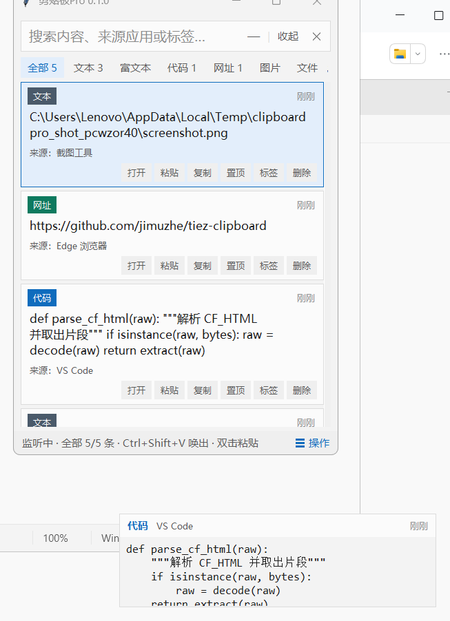
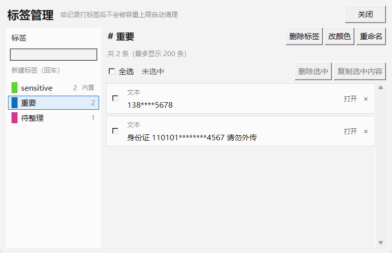

# 剪贴板Pro → TieZ Clipboard 完整 Python 重构：差距清单

- 对比基准：`G:\soft\tiez\tiez-clipboard-master`（Tauri 2 + Rust，117 个 `#[tauri::command]`）
- 现有实现：`G:\soft\Paste PRO\1st`（Python 3.12 + tkinter + ctypes + SQLite，38 个 `@guard` 命令）
- 口径（已与用户确认）：
  1. **只补缺失，不重头重写**——沿用现有 `domain / infrastructure / services / app / ui` 分层
  2. **按 TieZ 官方 local edition 做单机版**，排除云同步 / MQTT / 局域网传输 / 主题商店 / 自动更新 / 公告
  3. **不保留 AI**（用户最终确认：AI 模块整体删除，程序完全离线）
- 结论速览：**已有 21 项 · 缺失待补 74 项 · 按口径排除 22 项**

---

## 实施进度

| 批次 | 内容 | 状态 |
|---|---|---|
| — | 修复既有缺陷 13/14/15（设置窗口打不开、可重复打开、历史只能看 50 条） | ✅ 完成 |
| 批次 1 | 列表卡片 UI：图片缩略图、颜色色块、逐条操作按钮 | ✅ 完成 |
| 批次 2 | 系统集成（打开内容、文件定位、开机自启、Win+V、平台/提权） | ✅ 完成 |
| 批次 3 | 图标与关联应用（exe 图标、文件类型图标、打开方式、应用扫描） | ✅ 完成 |
| 批次 4 | 剪贴板核心补强（手动新增、置顶排序、临时粘贴、快捷键探测）+ 修掉信封嵌套 | ✅ 完成 |
| 批次 5 | 富文本完整链路（CF_HTML 解析、Office 清洗、截断、命名格式往返） | ✅ 完成 |
| 批次 6 | 顺序粘贴（FIFO 队列、自动入队、逐条粘出、Alt 补按） | ✅ 完成 |
| 批次 7 | 标签管理器（全局重命名、内置标签保护、颜色、多选批量操作） | ✅ 完成 |
| 批次 8 | 表情面板（Emoji 分组表、图片表情收藏、点一下即粘） | ✅ 完成 |
| 批次 9 | 隐私加密落盘 F9-3（DPAPI）+ 敏感规则扩展 | ✅ 完成 |
| 批次 10 | 应用级规则引擎（忽略采集 / 自动清洗）+ 全局规则的界面 | ✅ 完成 |
| 批次 11 | 窗口与交互（贴边停靠、失焦隐藏、窗口固定、多屏） | ✅ 完成 |
| 批次 12 | 音效（现场合成提示音，不带音频文件） | ✅ 完成 |
| 批次 13 | 视频类型 | ✅ 完成 |
| 批次 14 | 紧凑预览浮窗（定位算法 + 内容载荷 + 无焦点浮窗） | ✅ 完成 |
| 批次 15 | 带格式粘贴快捷键 + 录制模式 + 重启/提权重启 | ✅ 完成 |

### 实施进度：15 / 15 全部完成

**批次 15 本次落地的东西**

| 项 | 说明 |
|---|---|
| **带格式粘贴快捷键** | 不开面板，直接把最新一条**带格式**粘到当前窗口（默认 `Ctrl+Shift+Z`，与参考实现一致） |
| **`set_recording_mode`** | 录制快捷键期间临时让出全部全局快捷键 |
| **`relaunch` / `restart_as_admin`** | 重启程序、以管理员身份重启 |
| **`greet` / `get_app_logo`** | **不实现**：前者是 Tauri 脚手架的 hello-world 示例，后者是纯装饰（tkinter 侧没有对应素材） |

**`set_recording_mode` 修的是一个真 bug，不是补功能。**

一旦某个组合被 `RegisterHotKey` 注册，**Windows 会先把它截走**，我们的窗口
根本收不到那个按键。所以"想录一个当前已注册的快捷键"（比如想改
`Ctrl+Shift+V` 本身）永远录不上——用户只会觉得录制功能坏了。
现在录制期间会把全局快捷键全部让出去，录完立刻恢复。

**修 bug 时又发现同一个缺陷犯了第二次**：`_on_hotkey_substituted` 的
"降级后写回配置"只覆盖了 main/search 两个键。新加的 `rich_paste`
一旦被降级，**实际用的是备选键、界面上却还显示配置里的旧键** ——
和这个测试文件当初存在的理由（缺陷 B）是同一个问题。已补全。

**`auto_copy_file` 不在范围内（对差距清单的修正）**

差距清单原来把它列为"缺失的设置接口"，但查证发现它**完全存在于
`services/file_transfer/`**（局域网文件传输）里 —— 那是用户已确认排除的
联网模块。所以它不是"缺失功能"，而是"被排除的功能"，**不该实现**。
这说明差距清单当初的机械比对留下了误报。


**批次 15 本次落地的东西**

只做了一项 —— `rich_paste_hotkey`（**带格式粘贴快捷键**，默认 `Ctrl+Shift+Z`，
与参考实现一致）：不开面板，直接把最新一条**带格式**粘到当前窗口。

内核里 `paste_latest_rich` 早就有了，缺的只是全局快捷键注册。

| 改动 | 说明 |
|---|---|
| `ACTION_RICH_PASTE` | 监听器新增动作 + 5 个备选组合 |
| 注册策略 | **一直注册**（不像顺序粘贴那样只在模式开启时注册）——它是"不开面板直接粘"的常用路径 |
| 快捷键入口 | `_paste_latest_rich_safe()`：失败只提示不抛（快捷键回调里抛异常没地方接） |
| 设置界面 | 快捷键分区多一行，并写明**默认组合的代价** |

**⚠ 一处如实说明**：`Ctrl+Shift+Z` 在 Photoshop / VS Code 里是"重做"，
全局注册会把它抢走。参考实现也用的是这个默认值，所以保持了忠实；
但设置界面里明确写了这个代价，并给了 4 个备选组合，用户可以自己改。

**一处对差距清单的修正：`auto_copy_file` 不在范围内。**

差距清单原来把它列为"缺失的设置接口"，但查证之后发现它**完全存在于
`services/file_transfer/`**（局域网文件传输）里 —— 那是用户已经确认排除的
联网模块。所以它不是"缺失功能"，而是"被排除的功能"，
**不该实现**。这也说明差距清单当初的机械比对留下了误报。

**一处测试暴露的问题**：新加的带格式粘贴用例会调用粘贴流程，
而粘贴会**顺手收起面板**；不恢复状态的话，后面依赖"面板当前是显示的"
两个用例（托盘、暂停监听）会莫名其妙地失败。已在用例末尾把状态还回去 ——
**测试改了全局状态就必须还回去**，否则失败会出现在离现场很远的地方。


**批次 14 本次落地的东西**

新增 `app/services/preview_layout.py`（**纯定位逻辑**，不碰 Tk 也不碰 Win32）、
`app/ui/preview_window.py`（浮窗本体）、2 个内核命令、设置界面两个开关。



定位算法照搬参考实现的优先级：右下 → 右上 → 左下 → 左上 →
**主面板外侧**（右/左/上/下）→ 夹进屏幕。抽成纯函数之后，
这些判断用一块假想的 1920×1080 屏 + 一个假想的面板矩形就能完整单测。

浮窗是"体验"功能，**最怕帮倒忙**，所以定了四条纪律，每条都有对应断言：

| 纪律 | 为什么 |
|---|---|
| **绝不吃焦点** | 浮窗抢走焦点的话，用户接着敲键盘就没反应了。用 `overrideredirect` 去掉边框，且代码里**不出现** `.focus_force(` / `.focus_set(` / `.grab_set(` |
| **绝不挡住主面板** | 盖住面板等于逼用户先移开鼠标才能继续操作 |
| **绝不在鼠标移开之后才弹出来** | 悬停计时器带**请求号**，移开就作废；弹出前还要再确认一次鼠标仍在面板内 |
| **绝不跑到屏幕外** | 看不见的浮窗会让人以为程序坏了 |

| 内容类型 | 浮窗展示 |
|---|---|
| 文本 / 代码 / 网址 | 完整内容（代码用等宽字体），长文本截断到 4000 字并**如实标注** |
| 富文本 | 按约定降级为纯文本预览（见"需要确认的点"第 2 条） |
| 图片 | 原图等比缩放到 320px 内，附尺寸与文件大小 |
| 文件 / 视频 | 文件名 + 路径 + 大小；**文件已不存在时明确标出来** |
| 颜色值 | 直接给色块（`#0f6cbd` / `rgb(15,108,189)` 都认） |

另外：滚动、按键、收起面板时**自动收起浮窗** —— 滚动之后卡片位置变了，
浮窗会指着错误的位置。

**一条自我纠正**：我最初写的"不抢焦点"断言是 `check(True, ...)`，
那种永远通过的断言等于没测。改成真的去读源码查调用之后，**当场报了一次假阳性**
（文档字符串里正好写着"不调用 focus_force"），于是又改成用正则匹配
`.focus_force\s*\(` 这样的**调用形式**。


**本轮（批次 13 的视频部分）落地的东西**

TieZ 有 7 种离线类型，本项目原来只有 6 种，缺 `video`。

有意思的是：代码里**早就有 5 处写着 `in ("file", "video")`** —— 说明当初是
照着参考实现预留的，但这个类型从来没被真正生产出来过。

| 改动 | 说明 |
|---|---|
| `TYPE_VIDEO` | 加入 `ALL_TYPES` 与 `TYPE_LABELS`（界面筛选按钮自动多一个） |
| `is_file_type()` | **新增**。文件与视频在存储上完全一样（路径列表），判断时必须用它而不是直接比 `"file"`，否则很容易漏掉某个分支 |
| `looks_like_video()` | 16 种扩展名；**全部是视频才算**（混合内容按"文件"处理更合理）；认得大写扩展名、带查询串的链接、路径里的空白 |
| 类型判定入口 | `detect_content_type` 在 files 分支里多判一次 |
| 粘贴路径 | `_write_entry_to_clipboard` 改用 `is_file_type()` |

**AI 的处置：已按要求整体删除**

AI 一开始按"用户指定的例外"实现了（OpenAI 兼容接口、用户自填 API Key、
未配置时不启用），但用户随后明确要求**不需要 AI，模块先删掉**。已彻底移除：

| 移除对象 | 内容 |
|---|---|
| 服务层 | `app/services/ai.py`（提示词、请求体、响应解析、配置与 Key 加密） |
| 界面 | `app/ui/ai_result.py`（结果窗口）、设置里的 AI 分区、`AiProfileEditor` |
| 内核 | 6 个命令（get/set_ai_settings、check_ai_connectivity、call_ai、copy_ai_result 等） |
| 配置 | `ai_profiles`、`ai_target_lang`、`ai_thinking_budget`、三个指派键 |
| 快捷键/菜单 | 右键的「AI 处理」子菜单 |
| 测试 | `tests/ai_check.py` |

**验证方式**：全项目搜索 `ai_service` / `AiResultWindow` / `K_AI_` / `call_ai`
等标识全部为零命中；启动程序、采集、渲染、设置窗口、右键菜单均正常。

删掉之后，设置面板顶部那句"**程序不联网、不上传任何内容**"从"除 AI 之外
属实"变成了**完全属实** —— 项目里不再有任何发起网络请求的代码路径。


**批次 12 本次落地的东西**

新增 `app/infrastructure/sound.py` + 6 个内核命令 + 设置界面（开关/音量/试听）。

参考实现用 Web Audio **现场合成**提示音，这里照搬同样的参数在 Python 里
合成再播放——**不往用户磁盘上塞任何音频素材**：

| 环节 | 参数（与参考实现逐项对应） |
|---|---|
| 振荡器 | 三角波，频率从 `基频 × 1.25` 指数滑到 `基频 × 0.92` |
| 滤波器 | 带通，中心 `基频 × 1.3`，Q=6 —— 这是"清脆"的来源 |
| 增益包络 | 4ms 起音 → 降到 35% → 指数衰减 |
| 起音 | 一小段高通（1500Hz）噪声 |
| 复制 | 60ms / 500Hz |
| 粘贴 | **两声**：90ms / 950Hz，110ms 后 75ms / 1150Hz |

滤波器是照 RBJ cookbook 公式实现的双二阶，与 Web Audio 的
`BiquadFilterNode` 系数规则一致，所以音色对得上。

**踩到的一个硬约束：`winsound` 不支持从内存异步播放。**

```
SND_MEMORY                     OK（同步，阻塞）
SND_MEMORY | SND_ASYNC     FAIL: Cannot play asynchronously from memory
SND_FILENAME | SND_ASYNC       OK（但要落文件，实测会"文件正被占用删不掉"）
```

而且 `PlaySound` **即使播 60ms 的声音也会阻塞 200~600ms**（音频设备初始化
延迟，本机实测）。粘贴路径跑在界面线程上，同步播会让界面明显卡一下。

所以最终方案是**自己开一个后台线程同步播**：不落文件、不阻塞调用方。
另外做了两件事：

* **连发合并。** 始终只保留"最新的一段待播"，正在播的不打断。
  排队会让声音越来越滞后——**一个迟到一秒的提示音比没有提示音更让人困惑**。
* **只有一个播放线程。** `PlaySound` 是进程级的，多线程只会互相打断。

**提示音只在恰当的时机响**：新内容真正入库时响、真正粘出去时响；
重复内容被合并、被应用规则忽略、降级成"请手动粘贴"都不响——
那些时候响一声会让用户以为操作成功了。


**批次 11 本次落地的东西**

新增 `app/infrastructure/monitors.py`（显示器枚举）与
`app/services/window_behavior.py`（**纯几何逻辑**，不碰 Tk 也不碰 Win32），
面板侧接入，外加 8 个内核命令。

把几何判断抽成纯函数是有意的：贴边停靠、跑出屏幕修复、多屏比例重映射
这些逻辑用假想的双屏配置就能完整单测，不需要真的接两块显示器。

| 能力 | 要点 |
|---|---|
| 贴边停靠 | 5px 触发、露出 3px；**只支持左/右/上三条边**——下边缘是任务栏，吸下去会把面板压在任务栏底下 |
| 跑出屏幕修复 | 拔掉外接屏、改分辨率之后把窗口收回可见区域，并在日志里留痕 |
| 多屏比例重映射 | 21:9 副屏上靠右的位置拿到 16:9 主屏上，按比例映射而不是照搬坐标 |
| 失焦自动隐藏 | `app.ignore_blur` 可抑制 |
| 窗口固定 | 等价于"我要它一直在"：自动置顶 + 失焦不隐藏，不用再去改另外两个开关 |
| 焦点命令 | `activate_window_focus` / `restore_last_focus` / `hide_window_cmd` / `toggle_window_cmd` |
| 方向键开关 | `set_navigation_enabled` / `set_navigation_mode`（list / grid / none） |
| 设置界面 | 六个开关 + **显示检测到几块显示器**（多屏问题多半是这里对不上） |

**踩到的两个坑：**

1. **失焦隐藏把「最小化」吃掉了。** 最小化本身就会让窗口失焦，于是
   `_on_focus_out` → `hide()` → `withdraw()`，"最小化"和"关闭"变得毫无区别。
   这个回归是**既有的 `window_behavior_check` 当场抓出来的**——
   它原本就有一条"最小化后窗口状态为 iconic"。现在失焦处理会先看窗口状态，
   非 normal 就直接返回。

2. **`restore_last_focus` 用了一个不存在的方法。** 内核只有
   `set_paste_target` 没有读侧，命令直接报"内部错误"。已补上 `paste_target()`。

**一处 Tk 的坑（写测试时才发现的）**：Tk 会把 lambda 的**内存地址**写进绑定
脚本，所以"重新绑定之后脚本字符串相等"这个断言永远不成立。判断方向键有没有
绑上只能看"绑定是否为空"。


**批次 10 本次落地的东西**

新增 `app/services/app_rules.py` + 8 个内核命令 + 设置界面 + 右键快捷入口。

| 能力 | 要点 |
|---|---|
| 忽略采集 | 来自某应用的复制**根本不入库**（密码管理器、银行客户端） |
| 自动清洗 | 来自某应用的内容入库前先做正则替换（从 IDE 复制代码去掉行号） |
| 四种匹配写法 | 完整路径 / exe 名 / `/正则/` / MSIX AUMID，与参考实现一致 |
| 内容类型过滤 | 可选只对某几类生效 |
| **全局清洗规则的界面** | 此前流水线已支持 `pat=>rep`，但**只能改数据库**，现在有输入框了 |
| 试跑 | 编辑器里贴一段样例，立刻看到规则会怎么处理 |
| 右键快捷入口 | 「忽略此来源应用」——应用名与进程路径直接从记录里取 |

**四个刻意做的判断：**

1. **忽略采集要在处理之前生效。** 放在管线末尾等于白白解码图片、算指纹，
   最后才把结果丢掉。现在它是 Transformation 阶段的第一件事。

2. **`ignore` 与 `clean` 的类型语义相反，必须分清。** `ignore` 不写类型
   = 全部类型都忽略；`clean` 不写类型 = 不匹配任何内容。混淆了就会出现
   "以为忽略了其实没忽略"。

3. **写了 `clean` 却没有任何有效规则时，正确做法是"不干预"。**
   静默丢数据比不生效糟糕得多。

4. **类型闸门放在引擎里，不是只放在管线里。** 这是测试逼出来的改动：
   我原本只在管线里挡"图片/文件不参与文本清洗"，但引擎本身照洗不误，
   于是**试跑会说"会清洗"、实际管线却不清洗**——两处行为不一致。
   闸门移进引擎之后，试跑、脚本调用、管线看到的都是同一个结论。

**同时修掉了全局规则解析的两处偏差**：原来的实现用 `[\n|]{2,}|\n` 切分
（会把 `||` 当分隔符，与参考实现不一致），也不认 `#` 注释、不还原替换值里的
`\n`/`\t`。现在全局规则与应用规则**共用同一个解析器**，不会两处行为不一样。


**批次 9 本次落地的东西**

这一批把文档里从第一周就一直标着"未实现"的 **F9-3 敏感记录加密存储**做掉了。

新增 `app/infrastructure/encryption.py`，用 Windows DPAPI
（`CryptProtectData` / `CryptUnprotectData`）：

* 加密密钥由 Windows 按**当前用户**派生，程序自己不留密钥；
* 换用户、换机器都解不开；
* 不需要用户设密码，也就不存在"忘记密码导致数据全丢"。

密文写成 `dpapi:<base64>`。这个前缀是**自描述**的：读到一条记录先看前缀就知道
要不要解密，不需要额外的标志位，也就不会出现"标志位和实际内容对不上"的烂账。

| 能力 | 要点 |
|---|---|
| 加密落盘 | 敏感文本记录的 `content` / `preview` / `html_content` 三列都是密文 |
| 透明解密 | 解密集中在 `_row_to_entry` 一处，所有读路径都从这里走，不会出现"某个查询忘了解密、界面显示一串 base64" |
| **加密后仍可搜索** | 见下 |
| 敏感标签联动 | 打上 `sensitive` / `密码` 标签即自动加密；去掉标签则解密回明文 |
| 自愈对齐 | 启动时后台把"标记与实际落盘形态对不上"的记录修正过来 |
| 掩码设置 | 前后可见位数（0~20）、邮箱是否连域名一起打码 |
| 自定义规则 | 每行一条正则，坏行跳过并记日志——一条写错的正则不能让整块保护失效 |

**四个刻意做的判断：**

1. **图片/文件类不加密。** 它们的 `content` 是磁盘路径，加密之后附件清理、
   打开内容、换数据目录时的路径重写就全对不上了。这两类本来也不承载
   手机号/身份证这类文本隐私。

2. **加密之后还得搜得到。** 正文是密文时 SQL 的 `LIKE` 天然匹配不到，
   只走 SQL 的话"搜自己的手机号却搜不到"会让人以为记录丢了。所以检索会
   **补一遍内存匹配**（解密后比对，带上限避免全表解密）。

3. **去掉敏感标签不能撤掉识别器给出的保护。** 内容本身是身份证号时，
   删个标签就变回明文，那是把保护做成了摆设。只有内容确实不再敏感时才解密。

4. **加密失败退回明文。** 加密是"尽力而为"的保护，不该因为它失败就让用户
   连复制都用不了。

**同时修掉了一处会误导用户的旧文案**：设置窗口原本写着"敏感记录的加密落盘
安排在第三周，当前敏感内容在数据库中仍是明文"。这句话现在是**假的**，
已改成实时的加密状态显示（多少条已加密、是否全部对齐、一键对齐按钮）。


**批次 8 本次落地的东西**

新增 `app/infrastructure/emoji.py`、`app/data/emoji_data.json`、`app/ui/emoji_panel.py`。

| 能力 | 要点 |
|---|---|
| Emoji 分组表 | 10 组 / 372 个，随程序带一份 JSON，**完全离线**；读不到就退回内置精简表——绝不允许因为一个数据文件就整个面板打不开 |
| 图片表情收藏 | 存在 `<数据目录>/emoji_favorites/`，**按内容哈希命名**，同一张图重复收藏不会产生第二份 |
| data URL 收图 | 支持 `save_emoji_favorite_data_url`（解析 base64、按 MIME/魔数定扩展名） |
| 点一下即粘 | 走"临时粘贴"：先快照剪贴板、粘完还原，**不会覆盖用户原来的剪贴板内容** |
| 网格缩略图 | 收藏卡片显示 44px 缩略图而不是原图——收藏里可能有几 MB 的动图 |
| **目录穿越防护** | 删除收藏与取缩略图都会校验路径在收藏目录之内 |

**目录穿越这条是本批次最要紧的。** 路径来自界面，不校验的话一个构造出来的
相对路径就能删掉磁盘上任意文件。测试里专门造了一个"外面的文件"，
验证普通路径与 `..` 构造路径都删不掉它，而系统 `notepad.exe` 也完好无损。

界面入口：右键「表情…」。

**一处如实的限制**：Tk 把 Emoji 渲染成**单色轮廓字形**，不是彩色。
TieZ 跑在 WebView 里，用的是彩色 Emoji 字体。功能完全不受影响
（点一下粘出去的是真正的 Unicode 字符），只是观感不如彩色版。
换彩色需要在 Tk 里逐字渲染 372 张位图（Pillow 不支持 COLR 彩色字体，
得上 DirectWrite），代价明显不值。


**批次 7 本次落地的东西**

新增 `app/ui/tag_manager.py` + 仓储 `rename_tag` / `items_by_tag` + 内核 3 个命令。



| 能力 | 要点 |
|---|---|
| 全局重命名 | 目标标签**已存在时按合并处理**，而不是报错——用户想把"待用"并进"重要"，报错只会让他回去一条条手动改 |
| 按标签取条目 | `items_by_tag` 走 `EXISTS` 子查询，复用 `_SELECT_FIELDS` |
| **内置标签保护** | `sensitive` / `密码` / `password` 禁止改名与删除。它们是"敏感信息保护"的依据，改名之后新采集的敏感内容就不会再被打上标记，**保护会静默失效**——这种失效用户根本察觉不到，所以必须挡在入口。`list_tags` 会带上 `protected` 标记，界面据此**直接禁用按钮并说明原因** |
| 标签颜色 | 用户设了就用用户的；没设按名字哈希出一个颜色。哈希必须**稳定**（同一标签每次打开都一样），否则用户会以为自己设置丢了 |
| 标签管理器窗口 | 左侧标签列表（色点 + 名称 + 数量 + 「内置」标记），右侧该标签下的记录；全选、批量删除、批量复制、单条移出标签；单例窗口 |
| 冗余列同步 | `clipboard_history.tags` 是 `entry_tags` 的冗余，改名/删除后必须重建，否则列表里的标签芯片还是旧的 |

界面入口：右键「管理标签…」。


**批次 6 本次落地的东西**

新增 `app/services/paste_queue.py` + 6 个内核命令，对应 TieZ 的 `services/paste_queue.rs`
与 README 里"为高频办公场景设计的顺序拷贝/顺序粘贴工作流程"。

用法：从几个地方依次复制一堆片段 → 到目标文档里**按住 `Alt` 连按 `V`**，按一下粘一条。

| 命令 | 说明 |
|---|---|
| `get_paste_queue` | 队列内容 + 每条是否已失效 + 模式状态 |
| `set_paste_queue` / `clear_paste_queue` | 整体设置 / 清空 |
| `add_to_paste_queue` | 单条入队（右键菜单入口） |
| `set_sequential_mode` | 开关模式；开关都会**重新注册快捷键** |
| `paste_next_step` | 弹一条并粘出去 |

四个特意做的决定：

1. **合并的记录不进队。** 连续复制两次同样内容只会合并成一条，队列里塞两条
   一样的会让用户粘出重复内容。只有 `outcome == "inserted"` 才入队。
2. **失效项自动跳过。** 队列建好之后用户可能把某条删了，这时跳下一条而不是
   报错打断连续粘贴（`skipped` 字段告诉界面跳了几条）。
3. **快捷键只在模式开启时注册。** `Alt+V` 本身很常用，没开顺序粘贴还占着它
   会平白影响别的软件。关掉模式时一并注销，测试里两种状态都验证了。
4. **关掉模式就清空队列。** 留着上次没粘完的队列会让用户莫名其妙。

**`Alt` 补按是"连按 V"能连续工作的关键**：热键触发时系统会把 Alt 吃掉，
不补一次按下的话，第二次 V 就不再构成 `Alt+V`，连续粘贴会断在第一下。
`paste_next_step` 会先记下 Alt 是否被物理按住，粘完再补按一次。

**队列不落库**：它描述的是一次连续操作，"重启之后还留着上次没粘完的队列"
没有意义。


**批次 5 本次落地的东西**

新增 `app/infrastructure/clipboard/rich_text.py`（对应 TieZ 的 `services/clipboard/utils.rs` 里那一大块）。

| 能力 | 要点 |
|---|---|
| CF_HTML 解析 | 按**字节**切偏移；识别 UTF-8 / UTF-16LE；**优先 `StartHTML/EndHTML`（整篇）**，保住 `<head>` 里的 CSS；三级退路（砍头行 → 找第一个像标签的 `<`） |
| WPS 修复 | 它会把片段开头的 `<` 吃掉，发出 `table border=0 ...>`。按"看起来像标签就补回 `<`" |
| Office 清洗 | 删 `mso-*` 样式块与注释，但**按特征签名判断**——不能无差别删 `<style>`，用户自己的样式要留着 |
| 裸表格补壳 | Excel 常见只有 `<tr>/<td>` 没有 `<table>`，补一层否则预览散架 |
| 预览截断 | 表格按**行**切（第 10 个 `</tr>` 之后）并补 `</table>`；长文本按字符切。原来的写法在"整段超长文本包在一个 `<p>` 里"时会退化成只剩 `'<p>'` 三个字符 |
| 命名格式往返 | RTF 一律保留；电子表格来源额外保留 Biff 等私有格式。打包成 base64 塞进 HTML 注释，schema 不用改 |

**采集/粘回的接线**：读剪贴板时把命名格式打包进 `html_content`；粘回时先写正文与 HTML，**再追加**命名格式（顺序不能反，`write_*` 开头会 `EmptyClipboard`）。

**标记不能漏进预览**：`content_utils.strip_html` 先摘标记再提纯文本，否则预览里会冒出一大串 base64。

**这一轮踩到的三个真坑**（都是测试先发现的）：

1. **第一版解析把 CSS 丢了。** 用整篇偏移切出来之后，我又按 `StartFragment/EndFragment` 缩了一遍片段 —— 正好把 `<head>` 里的样式扔掉，恰好毁掉"优先整篇"的初衷。测试里的 CSS 断言当场抓出来。
2. **`_read_html_opened` 先 `decode("utf-8")` 一次，把 UTF-16 的宽字符解成了夹着一堆 NUL 的字符串**，后面的 UTF-16 识别再也没机会生效。现在原始字节直接交给解析器。
3. **长文本截断退化成三个字符**：在 `max_chars` 之前找最后一个 `>`，对于 `<p>` + 超长文本只会找到 `<p>` 自己。


**批次 4 本次落地的东西**

| 命令 | 说明 |
|---|---|
| `add_manual_item` | 手动新增记录。**不走剪贴板**，而是构造 `ClipboardData` 走同一条管线——类型判定、指纹、脱敏、容量裁剪与正常采集完全一致（测试里验证了"手动加的网址也被判成 url"） |
| `set_pinned_order` / `move_pinned` | 置顶区重排。仓储方法 `update_pinned_order` 早就写好了但**从未被调用过**，现在接上了 |
| `paste_transient` | 临时粘贴：先快照剪贴板 → 粘贴 → 等 250ms → 还原 |
| `paste_latest_rich` | 粘贴最新富文本；历史里没有富文本时退回最新一条，而不是毫无反应 |
| `test_hotkey_available` | 快捷键占用探测（设置界面保存前用） |

**顺带修掉一个既有缺陷：`@guard` 套两层信封。**

`copy_entry` 转发到 `paste_entry`，而两个都带 `@guard`，于是调用方拿到的是：

```python
{"ok": True, "data": {"ok": True, "data": {...}, "error": None, "timestamp": ...}}
```

得剥两层才能用。现在 `guard` 会先判断"这已经是一个标准信封了"，是就直接返回。
判据用的是**键集合精确匹配**（`{ok, data, error, timestamp}`），不留内部标记、不污染协议。

**临时粘贴的两个细节**

1. **快照用三态而不是两态**：正常快照 / `SNAPSHOT_UNSUPPORTED`（剪贴板上有内容但读不懂）/ `None`（本来就是空的）。
   读到"读不懂"时**什么都不做**——把用户看不懂的原始内容清掉，比还原失败更糟。
2. **还原前等 250ms**：目标应用还没把内容取走就还原，会粘出上一次的内容。

**快捷键探测踩到的坑**：直接试注册会把自己已注册的组合误报成"被其他程序占用"
（`RegisterHotKey` 是先到先得，我们自己的注册也占着这个组合）。
现在先比对当前生效的注册，是自己的就直接返回可用并标记 `ownedByUs`。

**界面入口**：右键「手动新增一条…」、置顶项右键「在置顶区上移/下移」、`Ctrl+↑`/`Ctrl+↓`。


**批次 3 本次落地的东西**

新增 `app/infrastructure/icons.py`（图标）与 `app/infrastructure/apps.py`（关联应用）。

| 功能 | 实现要点 |
|---|---|
| 可执行文件图标 | `ExtractIconExW` 取 HICON → pywin32 的 DC/Bitmap 画进 32 位 DIB → BGRA 拆成 RGBA → PNG。**GDI 句柄逐个显式释放**（`DestroyIcon`/`DeleteDC`/`DeleteObject`），漏掉的话刷几十次列表就把句柄耗光 |
| 文件类型图标 | `SHGetFileInfoW` + **`SHGFI_USEFILEATTRIBUTES`**：文件**即使不存在**也按扩展名给图标——历史记录里的文件多半早被删了 |
| 图标缓存 | 进程内缓存，键是「规范化路径 + 尺寸 + 类型」。`C:\A\B.exe` 与 `c:/a/b.exe` 命中同一条；不同尺寸分开存 |
| 系统默认程序 | `AssocQueryStringW`（`ASSOCSTR_FRIENDLYAPPNAME` / `ASSOCSTR_EXECUTABLE`），内容类型映射到扩展名 |
| 打开方式列表 | 注册表 `HKCU\...\FileExts\<ext>\OpenWithList` |
| 已安装应用扫描 | PowerShell `Get-StartApps` + 系统常用程序白名单；**只在设置页按需调用**（启动一次约 2 秒），绝不放在启动路径上 |
| 卡片图标 | 文件/视频类显示文件类型图标，其余显示来源应用图标（`source_app_path` 采集时就存了，不用再查前台窗口） |

> **踩到的真坑：注册表里的垃圾值。** 实测本机 `.txt` 的 OpenWithList 长这样：
>
> ```
> a = 'Microsoft.WindowsNotepad_8wekyb3d8bbwe!App'
> b = 'ab'          ← 垃圾
> c = 'adebc'       ← 垃圾
> d = 'WeChat.exe'
> MRUList = 'abcdef'
> ```
>
> 天真地枚举会把 `ab` / `adebc` 当成程序名显示在"打开方式"里。
> 现在按形态过滤：只接受 `*.exe`、含 `!` 的 UWP AppID、或含路径分隔符的值。
> UWP AppID 还会转成可读名（`Microsoft.WindowsNotepad_xxx!App` → `WindowsNotepad`）。


**批次 2 本次落地的东西**

新增 `app/infrastructure/os_integration.py`，一条硬规矩：**导入该模块不产生任何副作用**，
注册表读写只发生在显式调用的 `set_*` 里——尤其 Win+V 接管会真的把系统 Win+V 关掉，
绝不能顺手就做。

| 命令 | 说明 |
|---|---|
| `open_content` | 网址走浏览器；文件/视频/图片直接开原文件；纯文本与富文本落到 `%TEMP%\剪贴板Pro_<时间戳>` 再用默认程序打开 |
| `open_entry_location` | `explorer /select,` 定位并选中文件 |
| `open_data_folder` | 打开数据目录 |
| `get_platform_info` | `sys.getwindowsversion()` → build 号与 Win11 判定（阈值 22000） |
| `check_is_admin` | `OpenProcessToken` + `GetTokenInformation(TokenElevation)` |
| `get_autostart` / `set_autostart` | 写 `HKCU\...\Run`，值名 `剪贴板Pro`，并清掉旧值名 `tie-z`/`TieZ`（否则一次开机会被拉起两次） |
| `get_win_v_status` / `set_win_v_optimized` | `DisabledHotkeys` 增删 + 关/开系统剪贴板历史；归还时清策略锁 |
| `set_system_clipboard_history` | 把系统 Win+V 还回去 |
| `get_os_diagnostics` | 上面这些的状态汇总 |
| `send_system_notification` | 托盘气泡（`NIF_INFO`），面板收起时 toast 看不见，气泡更有用 |

两个特意做的设计：

1. **打开内容不重排列表。** 原仓储只有 `touch_entry`（会更新时间戳 → 记录跳到最前），
   "打开"只是用了一次，把用户正在翻找的列表顶乱很难受。所以新增了
   `increment_use_count`：只加计数、不动时间戳。粘贴仍然走 `touch_entry`（会重排，符合预期）。
2. **可测试性优先。** 真正会弹窗口的出口只有 `shell_execute` 一个函数，
   测试替换它就能断言"打算打开什么"，不会真的弹出资源管理器；
   纯逻辑（`plan_open`、`merge_disabled_hotkey`）全部拆成无副作用函数。

> 自启测试写的是**一次性值名** `剪贴板Pro_测试用`，测完立刻删掉；
> Win+V 只读状态、只测纯函数，绝不真的改注册表——那会把用户系统的 Win+V 关掉。


**批次 1 本次落地的东西**

| 项 | 说明 |
|---|---|
| 缩略图层 `app/infrastructure/thumbnails.py` | 长边 160px、按附件名缓存到 `<数据目录>/thumbs/`；用 mtime 判断新鲜度，命中缓存不重复解码；写入用"临时文件 + 原子替换"，避免半张图永久损坏缓存 |
| 采集时预生成 | 图片入库时顺手生成缩略图。放在采集而不是渲染时做，是因为采集只发生一次而列表每次刷新都重画 |
| 内核命令 `get_thumbnail` | 返回 base64 PNG，界面直接喂给 `PhotoImage`；非图片返回 4001、记录不存在 4004、附件丢失返回失败而不抛异常 |
| 孤儿缩略图清理 | 启动时随孤儿附件一起清理；另加 `get_thumbnail_cache_usage` / `clear_thumbnail_cache` |
| 卡片缩略图 | 图片卡片显示真实缩略图 + 尺寸说明；取不到缩略图时老实退回文本预览 |
| 颜色色块 | 整条内容就是颜色值时画色块。tk 只认 `#rrggbb`，所以 `#rgb`/`#rrggbbaa`/`rgb()`/`rgba()`/`hsl()` 都要先归一（`_normalize_color`，用 stdlib 的 `colorsys`） |
| 逐条操作按钮 | 每张卡片 5 个：粘贴 / 复制 / 置顶 / 标签 / 删除。按钮不再叠卡片级的单击与双击绑定，避免双击按钮误触粘贴 |

> 顺带一个验证：写这批代码时我漏了 `TYPE_TEXT` / `TYPE_CODE` 两个导入，
> **刚修好的 `static_check.py` 立刻报了出来**——正是它没能抓到
> `SettingsWindow` 那次漏报的同一类问题。检查器现在是真的有效。


---

## 〇、先说三个"不是缺功能，而是已经有毛病"的问题

审阅现有代码时发现三个真实缺陷，**已在本次修复**（都补了回归测试）：

| # | 问题 | 影响 | 状态 |
|---|---|---|---|
| 1 | `panel.py` 调用 `SettingsWindow(self)` 却从未导入该名字 | 右键「设置…」、`Ctrl+,`、托盘「设置」**三个入口全部 NameError**，界面上改不了任何设置 | ✅ 已修（延迟导入） |
| 2 | 设置窗口每点一次新建一个 | 点三下叠三个窗口 | ✅ 已修（单例） |
| 3 | 历史浏览固定 `limit=50` 且从不传 `offset` | 第 51 条以后的记录**除搜索外无法翻到** | ✅ 已修（真分页） |

**为什么原有 252 项回归没抓到第 1 个**：`ui_smoke.py` 是直接 `import SettingsWindow` 测的，恰好绕开了 `panel.open_settings()`；
而 `static_check.py` 的 `report()` 在**遍历结束后**才去读作用域栈，那时函数作用域早已出栈——**函数体里的未定义名字一个都没检查过**。
现在检查器改为"作用域出栈即记录"，并内置了 6 个自检用例（该报的报、不该报的不报），每次运行都会先证明自己有效。

---

## 一、命令接口对照（117 → 38）

### A. 已有等价（21 项，无需重做）

| 参考接口 | 现有等价 |
|---|---|
| `get_clipboard_history` | `get_history`（支持 limit/offset/type/source/pinned） |
| `search_clipboard_history` | `search_history` |
| `get_clipboard_content` | `get_entry` |
| `get_db_count` | `get_count` / `get_type_counts` |
| `clear_clipboard_history` | `clear_history`（保留置顶与标签） |
| `delete_clipboard_entry` | `delete_entry` |
| `toggle_clipboard_pin` | `toggle_pin` |
| `update_item_content` | `update_entry_content`（重算指纹、重判类型） |
| `update_tags` | `add_tag` / `remove_tag` |
| `create_new_tag` | `add_tag` |
| `delete_tag_from_all` | `delete_tag` |
| `get_all_tags_info` | `list_tags` |
| `get_tag_colors` | `list_tags`（含 color） |
| `set_tag_color` | `upsert_tag_color` |
| `copy_to_clipboard` | `copy_entry` / `paste_entry` |
| `get_settings` | `get_settings` + `settings` 对象 |
| `save_setting` | `update_setting` |
| `set_theme` | `set_theme` / `set_theme_mode` / `set_list_density` |
| `register_hotkey` | `set_hotkey` / `reapply_hotkeys` / `restart_listener` |
| `paste_text_directly` | `write_text_to_clipboard`（**部分**：只写剪贴板，不会直接注入） |
| `run` | `app/main.py` + 启动器 |

现有额外的（TieZ 没有的）：`preview_storage_limit`、`get_storage_usage`、`get_listen_status`、`get_diagnostics`、`copy_entry_as_file`。

### B. 缺失 · 离线 · 建议补（74 项，按批次分组）

#### 批次 1｜系统集成（18 项）— 优先级 P0
TieZ 里最"像个正经软件"的一批，也是当前最扎眼的空白。

| 参考接口 | 说明 |
|---|---|
| `toggle_autostart` / `is_autostart_enabled` | 写 `HKCU\...\CurrentVersion\Run`，值名 `TieZ`，带 `--minimized` |
| `trigger_registry_win_v_optimization` | 接管 Win+V：`DisabledHotkeys` 加 `V` + 关掉系统剪贴板历史 |
| `set_windows_clipboard_history` / `get_windows_clipboard_history` | 还原系统剪贴板历史 |
| `is_registry_win_v_optimized` | 查询接管状态 |
| `set_win_clipboard_disabled` | 上述的取反别名 |
| `check_is_admin` / `restart_as_admin` | 提权检测与重启 |
| `get_data_path` / `set_data_path` | 数据目录迁移（含库内绝对路径重写） |
| `open_data_folder` / `open_file_location` / `open_folder` / `open_file_with_default_app` | 资源管理器集成 |
| `relaunch` / `quit` / `restart_explorer` | 进程与外壳控制 |
| `get_platform_info` | Win10/Win11 判定（决定云母/亚克力可用性） |
| `send_system_notification` | 系统通知（现有只有面板内 toast） |

#### 批次 2｜图标与关联应用（5 项）— P0
| 参考接口 | 说明 |
|---|---|
| `scan_installed_apps` | 枚举已安装应用（PowerShell `Get-StartApps` + 系统应用白名单） |
| `get_executable_icon` | `ExtractIconExW` → 位图 → PNG data URL |
| `get_file_icon` | `SHGetFileInfoW`，不存在的扩展名走 `USEFILEATTRIBUTES` |
| `get_associated_apps` | 按扩展名查注册表 `OpenWithList` |
| `get_system_default_app` | `AssocQueryStringW` 查系统默认程序 |

> 这批是"卡片上显示来源应用图标 / 文件类型图标"的前置条件。现有 `source_app.py` 已经能拿到**进程路径**，只差把图标抠出来。

#### 批次 3｜顺序粘贴（3 项）— P0
| 参考接口 | 说明 |
|---|---|
| `get_paste_queue` / `set_paste_queue` | 队列状态（FIFO，元素是记录 id） |
| `paste_next_step` | 弹出队首 → 写剪贴板 → 发按键 → 记数/删除 |

配套：`app.sequential_mode`、`app.sequential_hotkey`（默认 `Alt+V`）、以及"按住 Alt 连按 V"时**重新按下 Alt** 的处理。

#### 批次 4｜表情面板（7 项）— P1
| 参考接口 | 说明 |
|---|---|
| `list_emoji_favorites` / `remove_emoji_favorite` | 收藏列表（`emoji_favorites/fav_<hash>.<ext>`） |
| `save_emoji_favorite` | 从本地文件收 |
| `save_emoji_favorite_data_url` | 从 `data:` URL 收 |
| `save_emoji_favorite_url` | 从 http(s) 收（**联网**，可选） |
| `get_file_size` | 收藏前校验大小 |
| `save_file_copy` | 「另存为…」 |

配套 UI：表情库（本地 `emoji-data.json`，离线）、收藏网格、拖放投递、点击直接粘贴（`paste_text_directly` / `paste_content_transiently`）。

#### 批次 5｜标签增强（2 项）— P1
| 参考接口 | 说明 |
|---|---|
| `rename_tag_globally` | 全局重命名标签 |
| `get_tag_items` | 按标签取全部条目（现有只能搜索） |

配套：标签管理器界面（侧栏 + 颜色 + 多选批量删/复制 + 内置 `sensitive`/`密码` 标签禁止改名删除）、标签颜色哈希算法。

#### 批次 6｜剪贴板核心能力补强（6 项）— P0
| 参考接口 | 说明 |
|---|---|
| `add_manual_item` | 手动新增一条记录 |
| `update_pinned_order` | 固定项拖拽排序落库（现有仓储方法已存在但**从未被调用**） |
| `paste_latest_rich` | 粘贴最新富文本（绑 `app.rich_paste_hotkey`） |
| `paste_content_transiently` | 临时粘贴（**先快照剪贴板，粘完再还原**） |
| `open_content` | 打开内容（URL 用浏览器 / 文件用默认程序 / 文本用外部编辑器） |
| `test_hotkey_available` | 快捷键占用探测（现有内部有 `_register_exact`，但没暴露） |

其中 `open_content` 还带**外部编辑器回写**：临时文件 + 每秒轮询 mtime（最多 1 小时），存盘后把改动写回数据库。

#### 批次 7｜富文本完整链路 — P0
不是单个接口，而是一条链路，现在只有半条：

| 项 | 现状 | TieZ |
|---|---|---|
| CF_HTML 解析 | ✅ 有（按字节切） | ✅ 更完整：优先 StartHTML/EndHTML、`<!--StartFragment-->` 回退、修 WPS 被吃掉的 `<` |
| 富文本采集开关 | 默认**开** | 默认**关** |
| 保留命名格式 | ❌ 无 | Excel/RTF 等格式经 base64 存在 HTML 注释里往返 |
| 位图回退 | ❌ 无 | `<!--TIEZ_RICH_IMAGE:…-->` 标记 |
| HTML 清洗 | ❌ 无 | 剥 Office 噪声、裸 `<tr>` 自动补 `<table>` |
| HTML 预览截断 | ❌ 无 | 5000 字 / 10 行表格 |
| 粘贴带格式 | 恒为 True，无开关 | 独立快捷键 + 右键=带格式复制 |

#### 批次 8｜隐私与加密（4 项 + 加密）— P1
| 项 | 现状 | TieZ |
|---|---|---|
| 识别类型 | 4 类（身份证/手机号/邮箱/密钥） | 6 类（多 url、弱口令启发式） |
| 自定义规则 | ❌ | 用户填正则 |
| 掩码位数设置 | ❌ 固定 | 前/后可见位数、邮箱是否连域名掩码 |
| 敏感标记 | `is_sensitive` 列有，`mark_sensitive` **从未被调用** | 打 `sensitive` 标签 |
| **落盘加密** | ❌ 明文 | **DPAPI（`CryptProtectData`）加密 content/preview/html** |

TieZ 用 `CryptProtectData`（用户域）加密敏感记录，并用后台线程做"自愈对齐"（该加密的加密、不该加密的解密）。
Python 侧可直接用 `ctypes` 调 `crypt32.dll`，无需额外依赖。

#### 批次 9｜高级设置：应用级规则引擎 — P1
| 参考接口 | 说明 |
|---|---|
| `set_app_cleanup_policies` | 按应用配置「忽略采集」或「清洗替换」，支持路径/正则/exe 名/MSIX |
| `set_cleanup_rules` | 全局规则（现有流水线已支持 `pat=>rep`，但**没有界面**，只能改数据库） |

规则序列化：`# label: 名称` + `匹配 => 替换`，动作=忽略时替换值写魔法串 `__IGNORE_CAPTURE__`。

#### 批次 10｜窗口与交互（7 项）— P1
| 参考接口 | 说明 |
|---|---|
| `activate_window_focus` / `focus_clipboard_window` | 显式取焦点（输入框聚焦时用） |
| `restore_last_focus` | 失焦后还原给上一个窗口 |
| `hide_window_cmd` / `toggle_window_cmd` | 命令式显隐 |
| `set_navigation_enabled` / `set_navigation_mode` | 方向键导航状态同步 |

配套：**贴边停靠**（5px 触发、3px 露出、停靠时临时置顶且不改配置）、失焦自动隐藏（`app.ignore_blur` 抑制）、窗口固定 `app.window_pinned`、多显示器比例重映射、跑出屏幕修复。
另有 `set_edge_docking` / `set_follow_mouse` / `set_ignore_blur` / `set_window_pinned` / `set_tray_visible` / `set_arrow_key_selection` / `set_silent_start` 等设置接口（现有多数只能直接改数据库）。

#### 批次 11｜音效（1 项）— P2
`set_sound_enabled`。TieZ 用 Web Audio **现场合成**（三角波 + 带通 + 噪声起音），不是音频文件。Python 侧可用 `winsound.Beep` 或 wave 合成播放。

#### 批次 12｜AI（2 项）— P1（用户指定的例外）
| 参考接口 | 说明 |
|---|---|
| `check_ai_connectivity` | 校验 endpoint / key / model 是否可用 |
| `call_ai` | 三种动作：`task`（任务）/ `mouthpiece`（嘴替）/ `translate`（翻译） |

配套：模型库（多 profile）、按动作分配模型、翻译目标语言、Thinking 预算、`[[QUESTION:…]]` 追问机制。
敏感配置（`ai_profiles`）按 TieZ 口径应 DPAPI 加密。

#### 批次 13｜内容类型与其它（视频 + 12 项设置接口）
- **`video` 类型缺失**：TieZ 有 7 种离线类型（text/code/url/rich_text/image/file/**video**），现有只有 6 种。`mp4/mkv/avi/mov/wmv/flv/webm` 应识别为 video。
- 其余设置接口：`set_capture_files`、`set_capture_rich_text`、`set_deduplication`、`set_delete_after_paste`、`set_persistence`、`set_follow_mouse`、`set_privacy_protection`、`set_privacy_protection_kinds`、`set_privacy_protection_custom_rules`、`set_rich_paste_hotkey`、`set_search_hotkey`、`set_sequential_hotkey`、`set_sequential_mode`、`set_arrow_key_selection`、`set_silent_start`、`set_sound_enabled`、`set_tray_visible`、`set_window_pinned`、`set_ignore_blur`、`set_edge_docking`、`set_auto_copy_file`、`set_cleanup_rules`、`set_app_cleanup_policies` —— 现有多半能用 `update_setting` 兜底，缺的是**专门的设置界面**和少数几项的实际逻辑。

#### 批次 14｜列表与卡片 UI（无对应接口，但差距最大）— P0
按 TieZ 前端实测，现有卡片缺：

- **图片缩略图**（`image_to_thumbnail_png` 已实现但**从未被调用**）
- **文件类型系统图标** + 路径左截断
- **逐条操作按钮**：显示/隐藏敏感、打开、置顶、标签、AI、删除
- **快捷粘贴槽位提示**（修饰键 + 1..9/0，**最多 10 个固定项**）
- **相对时间**（TieZ 有；现有 `_human_time` 有，但无"昨天/星期"细分）
- **颜色值色块预览**（`#rrggbb` / `rgb()` 等直接显示色块）
- **虚拟滚动**（现有是分批渲染 + 50 条上限；TieZ 用 react-virtuoso，`overscan=200`）
- **多选与批量操作**（`delete_entries` 已存在但**无界面**）
- **来源应用筛选 / 仅置顶 / 按标签筛选**（后端参数都在，界面没接）
- **`tag:` 前缀查询语法**（`tag_only` 参数存在但面板从不置 True）
- **紧凑模式与独立预览浮窗**（`always-on-top` + 鼠标穿透 + 自适应尺寸的第二窗口）

### C. 按口径排除（22 项，联网）

| 分组 | 接口 |
|---|---|
| 云同步（4） | `cloud_sync_now`、`get_cloud_sync_status`、`request_cloud_sync`、`restart_cloud_sync_client` |
| MQTT（3） | `get_mqtt_running`、`get_mqtt_status`、`restart_mqtt_client` |
| 局域网文件传输（14） | `toggle_file_server`、`get_file_server_status`、`get_local_ip_addr`、`get_available_ips`、`set_display_ip`、`send_file_to_client`、`send_chat_message`、`get_chat_history`、`get_active_file_transfer_path`、`get_download_url`、`get_app_logo`、`save_temp_image`、`set_recording_mode`、`set_file_server_auto_close` / `set_file_transfer_auto_open` |
| 其它（1） | `get_available_ips` |

前端对应排除：主题商店（登录/评分/上传）、自动更新、公告轮询。

---

## 二、设置项对照

| | 参考 | 现有 |
|---|---|---|
| 键数 | ~70（含 20 余个联网键） | 21 |
| 落盘加密 | 敏感键 DPAPI 加密 | 无 |
| 有键无逻辑 | — | `app.edge_docking`、`app.sound_enabled`（**定义了但没人读**） |
| 有逻辑无界面 | — | `app.follow_mouse`、`app.silent_start`、`app.cleanup_rules` |

现有 21 键：`persistent`、`persistent_limit_enabled`、`persistent_limit`、`deduplicate`、`capture_rich_text`、`capture_files`、`delete_after_paste`、`cleanup_rules`、`privacy_protection`、`privacy_protection_kinds`、`theme`、`theme_mode`、`list_density`、`main_hotkey`、`search_hotkey`、`edge_docking`、`follow_mouse`、`silent_start`、`sound_enabled`、`always_on_top`、`window_geometry`。

---

## 三、数据层对照

**表结构已经对齐**，无需重建：`clipboard_history`（13 列）、`settings`、`saved_tags`、`entry_tags`、`schema_migrations` + 5 个索引，与参考的 migration 1–6、9 一致。

差异：
- 参考多 `cloud_sync_tombstones`、`cloud_sync_local_index`（**联网，排除**）
- 参考 `saved_tags` 预置 `sensitive` 与 `密码` 两个内置标签；现有没有
- `is_truncated` 在现有实体类里有、流水线也设了值，但**不是数据库列**，`save()` 不写 → API 里恒为 `False`
- `SourceAppInfo.window_title` 采集了但从不落库，`ClipboardData.clipboard_formats` 同理

---

## 四、建议实施顺序

按"用户能立刻感知 + 依赖关系"排序，每批做完跑全量回归：

| 批次 | 内容 | 理由 |
|---|---|---|
| 1 | 列表卡片 UI 增强（缩略图、逐条按钮、来源图标前置） | 一眼能看出差别 |
| 2 | 系统集成（自启、打开内容/文件夹、Win+V、数据目录迁移） | "像个正经软件" |
| 3 | 图标与关联应用 | 卡片 UI 的前置 |
| 4 | 剪贴板核心补强（手动新增、置顶排序、临时粘贴、打开内容+外部编辑器回写） | 核心链路加深 |
| 5 | 富文本完整链路 | 现有只做了半条 |
| 6 | 顺序粘贴 | 完整功能，工作量可控 |
| 7 | 标签管理器 + 标签增强 | 独立界面 |
| 8 | 表情面板 | 独立界面 |
| 9 | 隐私加密（DPAPI）+ 敏感规则扩展 | 补上一直标注"未实现"的 F9-3 |
| 10 | 高级设置规则引擎 | 中等 |
| 11 | 窗口行为（贴边停靠、失焦隐藏、窗口固定、多屏） | 中等 |
| 12 | 音效、视频类型 | 小 |
| 13 | 视频类型 | 补齐类型系统（AI 已按要求整体删除） |
| 14 | 紧凑预览浮窗 + 卡片 UI 收尾 | 最后做，工作量最大 |
| 15 | 带格式粘贴快捷键 + 录制模式 + 重启/提权重启 | 收尾 |

---

## 五、需要你确认的点（均已结清）

1. ~~**AI 的默认 endpoint**~~ —— **作废**：用户最终确认不需要 AI，模块已整体删除。
2. **富文本快照预览** —— 按降级方案实施：**直接显示纯文本预览 + 双击带格式粘贴**。
   （紧凑预览浮窗里也沿用这条口径。）
3. **文档口径** —— 用户表示不用改写。`文档/` 里保留原本的分阶段叙述，
   本差距清单负责记录"补全阶段"的完整过程。
